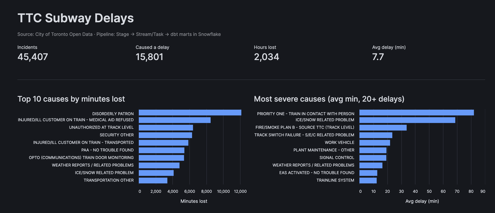
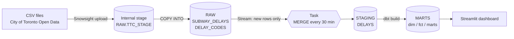
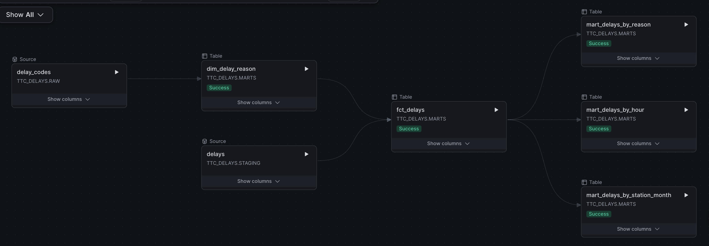
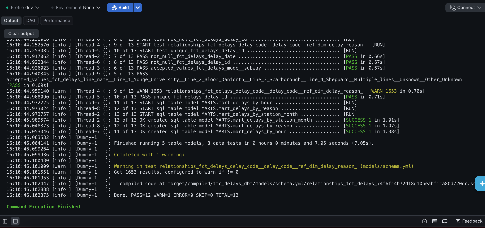
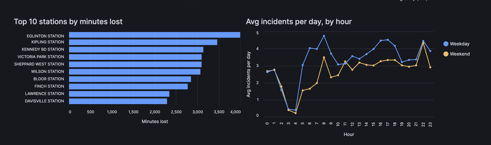
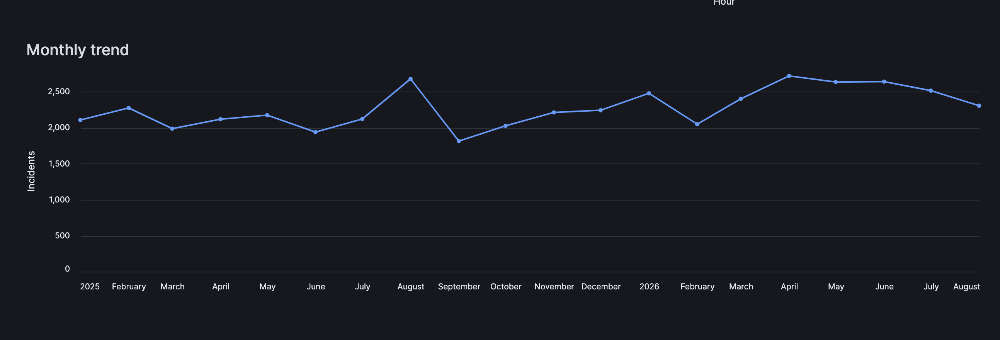

# TTC Subway Delays: End-to-End ELT Pipeline on Snowflake

An end-to-end data pipeline built entirely inside **Snowflake**, using Toronto's open TTC subway delay data (Jan 2025 – Aug 2026, ~45K incidents).
Raw CSV files are loaded into a stage, incrementally processed with **Streams + Tasks**, modeled and tested with **dbt**, and served through a **Streamlit in Snowflake** dashboard.



---

## Architecture



| Layer | Schema | What happens |
|---|---|---|
| **Raw** | `RAW` | Files land as-is (all `TEXT`) with `_SOURCE_FILE` and `_LOADED_AT` metadata |
| **Staging** | `STAGING` | Typed, standardized, de-duplicated via Stream + Task + idempotent `MERGE` |
| **Marts** | `MARTS` | dbt models: dimension, fact, and 3 aggregated marts, with data tests |
| **Serving** | – | Streamlit in Snowflake dashboard reading the marts |

## Tech stack

**Snowflake** (warehouses, internal stages, file formats, `COPY INTO`, Streams, Tasks, `MERGE`) · **dbt** (dbt Projects on Snowflake) · **Streamlit in Snowflake** · **SQL** · **Python** (pandas, Altair)

## Repository structure

```
snowflake/
  01_setup_and_load.sql   # warehouse, schemas, file format, stage, RAW tables, COPY INTO
  02_stream_task.sql      # STAGING table, stream, task with idempotent MERGE
dbt/
  dbt_project.yml
  profiles.yml
  models/
    sources.yml           # RAW + STAGING sources
    schema.yml            # data tests
    dim_delay_reason.sql  # delay code -> cleaned description
    fct_delays.sql        # one row per incident, enriched
    mart_delays_by_reason.sql
    mart_delays_by_hour.sql
    mart_delays_by_station_month.sql
streamlit/
  streamlit_app.py        # dashboard
docs/images/              # screenshots
```

---

## Key design decisions

- **RAW stays raw.** Everything is loaded as `TEXT` so a bad value never fails a load. Typing happens downstream with `TRY_TO_DATE`, `TRY_TO_NUMBER`, etc.
- **Incremental, not full reload.** An append-only **Stream** tracks only new rows in RAW. The **Task** runs only `WHEN SYSTEM$STREAM_HAS_DATA(...)`, so no credits are spent when nothing changed.
- **Idempotent loads.** Each incident gets a `SHA2` hash key (`delay_id`). `MERGE ... WHEN NOT MATCHED` means re-running the load never creates duplicates.
- **Cost control.** X-Small warehouse with `AUTO_SUSPEND = 60`; task kept suspended unless needed.
- **Medallion layout.** RAW → STAGING → MARTS keeps responsibilities separate and makes debugging easy.

## Data quality problems found and fixed

| Problem | Fix |
|---|---|
| Rows with an extra trailing column failed `COPY INTO` | `ERROR_ON_COLUMN_COUNT_MISMATCH = FALSE` on the file format |
| `CONCAT_WS` returns `NULL` if any input is `NULL`, so some `delay_id`s were `NULL` | `COALESCE` every column before hashing (caught by dbt `not_null` test) |
| Exact duplicate rows in the source file | `QUALIFY ROW_NUMBER() OVER (PARTITION BY delay_id ...) = 1` (caught by dbt `unique` test) |
| Encoding errors (`â€`) in delay descriptions | Regex replacing any non-ASCII sequence in `dim_delay_reason`, then a full `dbt build` to propagate downstream |
| 38 inconsistent spellings of subway lines (`YU`, `YUS`, `Y/U`, `LINE 1`…) | Normalized to 7 clean categories in `fct_delays` |
| 1,653 incidents use delay codes missing from the official code list | Kept as `'Unknown code'` and flagged by a `relationships` test with `severity: warn` |

## dbt tests

8 tests across the models: `unique` and `not_null` on keys, `accepted_values` on mode and line, and a `relationships` test between the fact and the delay-reason dimension.

```
Done. PASS=12 WARN=1 ERROR=0 SKIP=0 TOTAL=13
```

The single warning is intentional: undocumented delay codes are a real property of the source data, not a pipeline bug.





---

## Findings

| Metric | Value |
|---|---|
| Incidents | 45,407 |
| Incidents that caused a delay | 15,801 |
| Total time lost | ~2,034 hours |
| Average delay (when a delay occurred) | 7.7 min |

- **Disorderly patrons** cause the most total lost time (~12,000 minutes).
- **Priority One incidents** (train in contact with a person) and **ice/snow problems** are the most severe, averaging ~80 and ~70 minutes per delay.
- **Line 1 (Yonge-University)** accounts for ~51% of incidents, **Line 2 (Bloor-Danforth)** ~44%.
- **Eglinton, Kipling and Kennedy**, all terminal or interchange stations, lose the most minutes.
- Weekday incidents peak at the **8 AM rush** (~4.8/day vs ~3.5 on weekends). Both weekdays and weekends spike around **10 PM**.





---

## How to run

1. Create a Snowflake account and run `snowflake/01_setup_and_load.sql` up to the stage creation.
2. Download *TTC Subway Delay Data* and *Code Descriptions* from the [City of Toronto Open Data portal](https://open.toronto.ca/dataset/ttc-subway-delay-data/) and upload them to `@TTC_DELAYS.RAW.TTC_STAGE/Subway/` (Snowsight → Ingestion → Add Data).
3. Run the rest of `01_setup_and_load.sql`, then `02_stream_task.sql`.
4. Create a dbt project in Snowsight Workspaces with the files in `dbt/` and run **Build**.
5. Create a Streamlit app in Snowsight and
